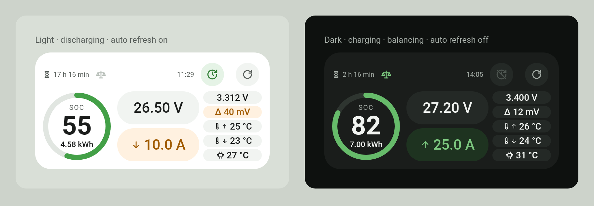

# Widget design — 4×2

Status: design only, not built yet. It is the input for the widget part of
spec 0002. The design was made on a design canvas; this folder keeps the
latest version in the repo.

Current version: **v2**. On the canvas each version is a separate board
(newest at the bottom); git keeps the older versions of this folder.



| File | What it is |
|---|---|
| `widget-4x2.html` | Live copy of the design. Open it in a browser. 1 px = 1 dp. |
| `widget-4x2.png` | Render of the HTML file (2× scale). |

## Layout

Main rule: the most important data sits on the left, and importance drops
to the right: SOC, then pack voltage and current, then cell details.

Card: 360 × 180 dp, 12 dp padding, 24 dp corner radius.

```
 ⌛ 17 h 16 min  ⚖               11:29  (⟳auto) (↻)

 ╭─────╮  ╭───────────╮  ( 3.312 V )
 │ SOC │  │  26.50 V  │  ( Δ 40 mV )
 │ 55  │  ╰───────────╯  ( 🌡↑ 25 °C )
 │ kWh │  ╭───────────╮  ( 🌡↓ 23 °C )
 │     │  │ ↓ 10.0 A  │  ( ▣ 27 °C )
 ╰─────╯  ╰───────────╯
```

- **Top row (44 dp), full width:** time left, balancing icon, last update
  time, auto-refresh toggle, manual refresh (top-right corner). Each button
  shows a 36 dp circle inside a 44 dp touch area.
- **Gap:** 4 dp under the top row, so 8 dp from the button circles to the
  pills. No divider line.
- **SOC ring (104 dp, 8 dp stroke):** small "SOC" label, the number without
  "%", kWh left below it. The ring shows the charge level.
- **Middle column, pack (takes the free width, about 118 dp):** two big
  pills, each half the column height (51 dp, 6 dp gap): pack voltage, then
  current. The current has no sign: the arrow and the colour show the
  direction. This leaves room for 3-digit currents ("↓ 125.5 A" fits).
- **Right column, cells (90 dp):** five small pills, 19 dp high: average
  cell voltage, cell delta, highest sensor temperature, lowest sensor
  temperature, MOSFET temperature.
- All pills show numbers only (no text labels).

## Data

Entity names use the ESPHome JK-BMS naming with a user prefix, for example
`bps_bms` → `sensor.bps_bms_total_voltage`.

| Element | Source | Note |
|---|---|---|
| SOC | `sensor.<p>_state_of_charge` | |
| kWh left | computed | Ah left × total voltage / 1000 |
| Ah left | `sensor.<p>_capacity_remaining` | Not shown; input for kWh and time left |
| Voltage | `sensor.<p>_total_voltage` | |
| Current | `sensor.<p>_current` | The sign gives the state: < 0 discharging, > 0 charging, 0 idle (likely; check on the real BMS). Shown without the sign, with an arrow |
| Time left | computed | Discharging: Ah left / \|I\|. Charging: (full − Ah left) / I. "—" when idle |
| MOSFET temp. | `sensor.<p>_mosfet_temperature` | |
| Highest / lowest temp. | computed | Max / min over the available `sensor.<p>_temperature_sensor_1…N` |
| Average cell | `sensor.<p>_average_cell_voltage` | |
| Cell delta | `sensor.<p>_delta_cell_voltage` | Shown in mV |
| Balancing | `binary_sensor.<p>_balancing` | |
| Update time | app | Time of the last successful sync |
| Auto refresh | app setting | Turns periodic sync on or off |

## Colours and levels

| Element | Rule |
|---|---|
| SOC ring | green ≥ 25 %, amber < 25 %, red < 15 % |
| Current pill | amber when discharging, green when charging, grey when idle |
| Delta pill | plain ≤ 15 mV, amber > 15 mV, red > 40 mV |
| Temperature pills | plain (no limits set yet) |
| Balancing icon | green when on, grey when off |
| Auto-refresh toggle | green tonal when on; grey with a slash when off |
Theme tokens (light / dark) are the CSS variables at the top of
`widget-4x2.html`. The app theme is green; no blue.

## Font sizes

These are the groups for the widget font-size settings (spec 0002):

| Group | Default |
|---|---|
| SOC number | 40 sp |
| kWh under SOC | 12 sp |
| Main values (voltage, current) | 22 sp |
| Cell pill values | 14 sp |
| Small text (SOC label, time left, update time) | 10.5 sp |

## Notes for the build

- Glance has no ring-shaped progress view (likely), so the ring will be a
  bitmap drawn at run time, with the content description "State of charge
  N percent".
- Every icon-only element needs a content description: current direction,
  balancing, MOSFET, highest and lowest temperature, both buttons.
- The buttons have a 44 dp touch area (36 dp visible circle). Android
  advises at least 48 dp for touch targets; use 48 dp if the row still fits.
- The ring content is tight: at the default sizes the kWh line has about
  3 dp of room inside the ring. The SOC and kWh font-size settings need
  upper limits.
- Open: temperature warning limits; whether min and max cell voltage appear
  on the widget (the sensors exist, the design does not show them).
