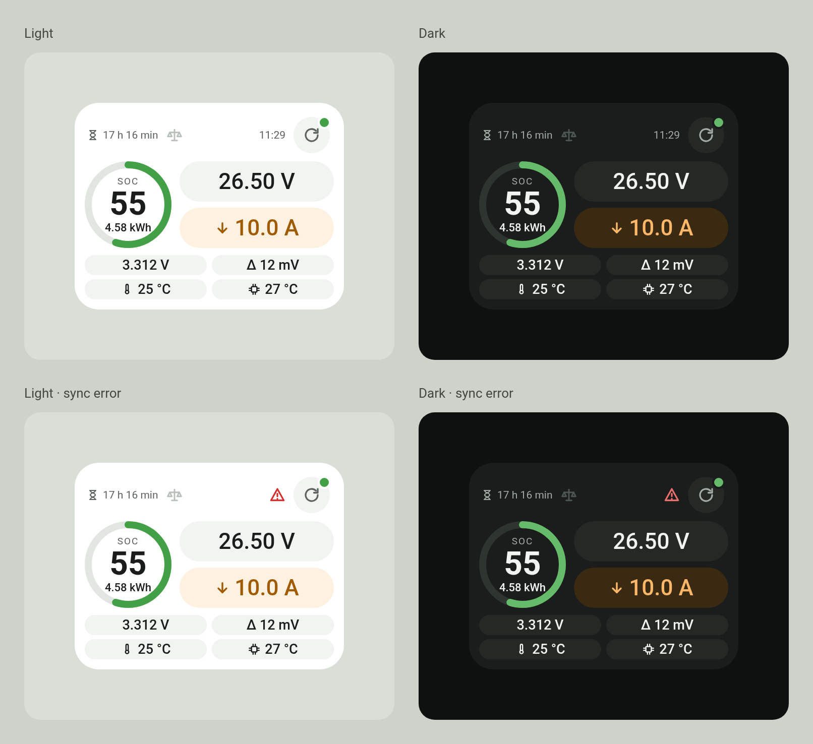
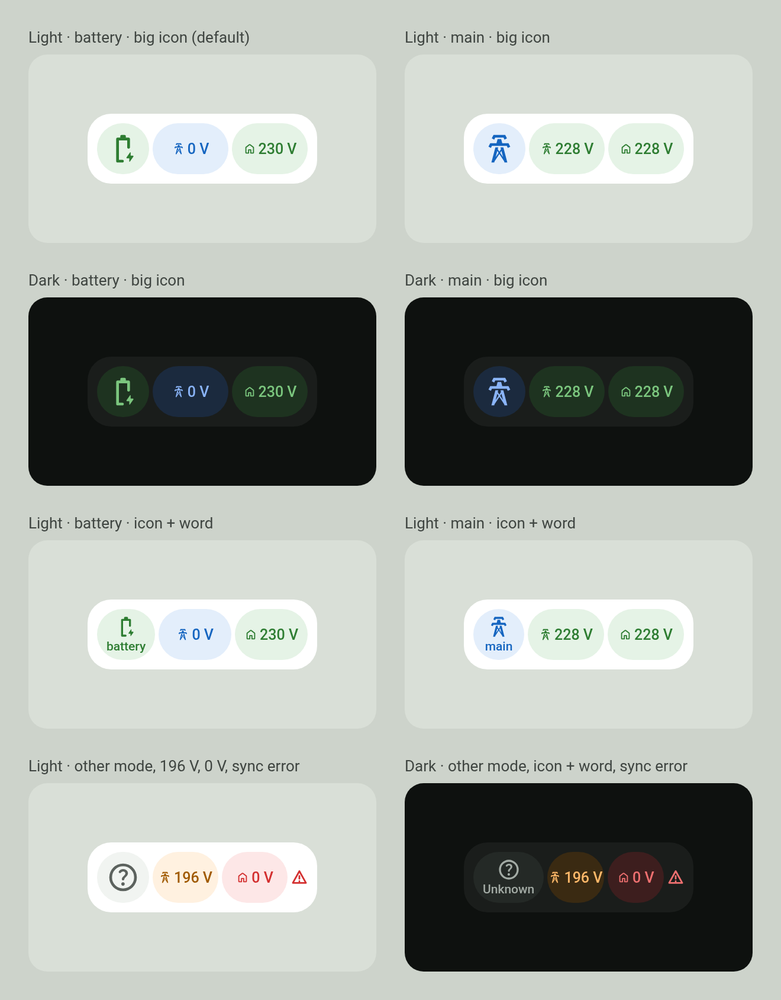
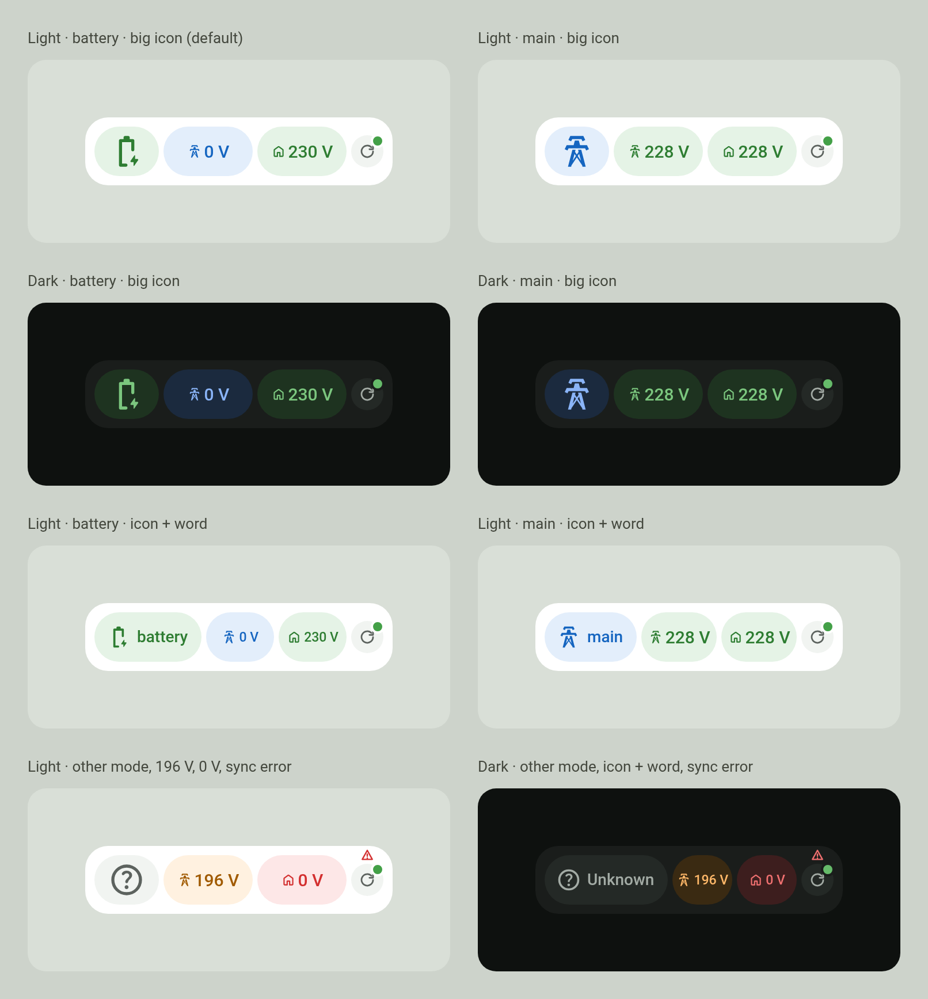
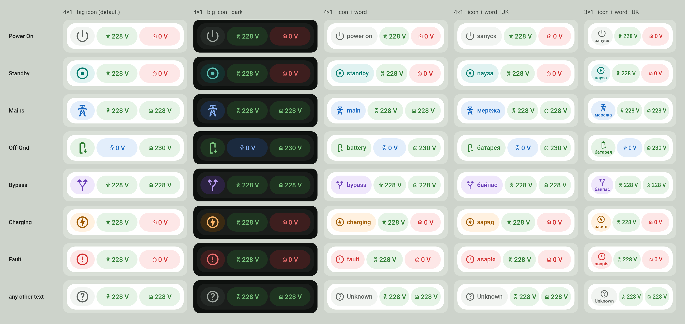
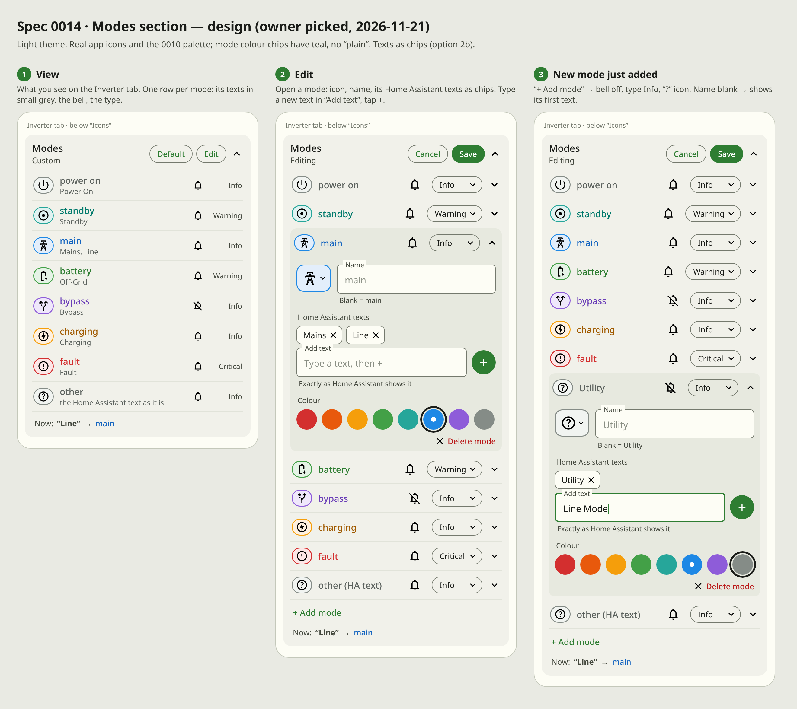
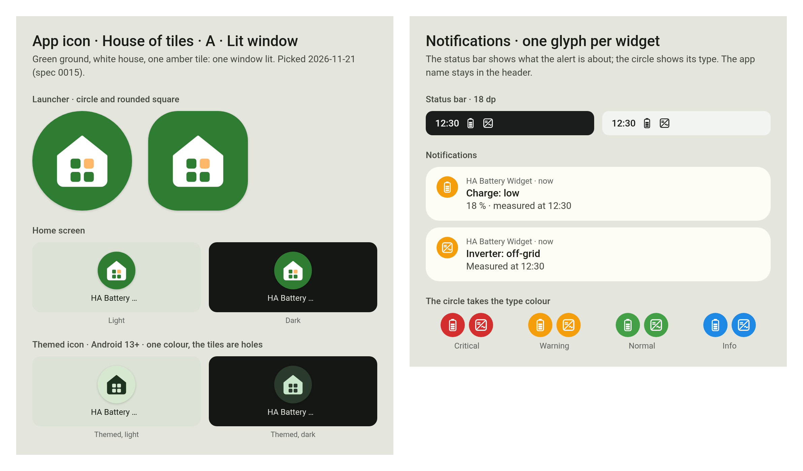
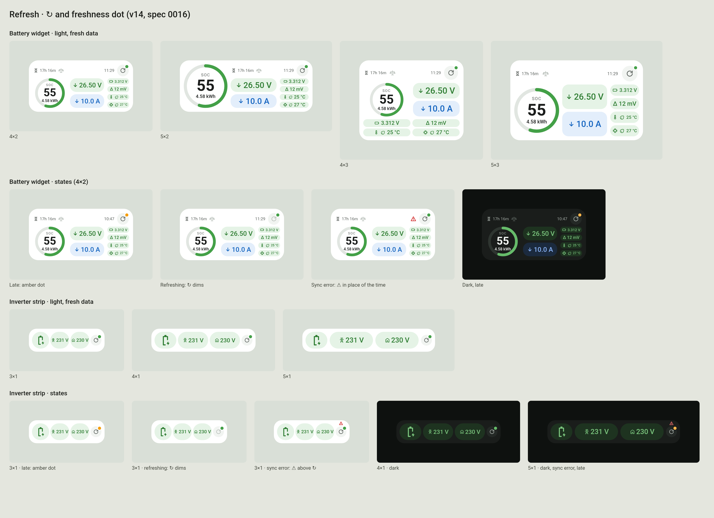

# Widget design — 4×2, 5×2, 4×3, 5×3

The inverter strip (3×1, 4×1, 5×1, spec 0012) has its own section near the
end, "Inverter strip". The app's Modes section (spec 0014) follows it,
"Mode editor". The app icon and the notification icons (spec 0015) come
next, "App icon". The refresh controls of both widgets (↻ and the freshness
dot, spec 0016) come last, "Refresh".

Status: built (layouts spec 0005, temperatures 0004, value colours and
levels 0010–0013, ↻ and the freshness dot 0016).

The design lives on a design canvas that holds only the current design, in
sections: Battery widget, Inverter strip, Inverter modes, Mode editor (app),
App icon, Icon ideas, Widget family. This folder keeps its copy in the
repo; git keeps the older versions (v4 up to commit d1cf5fc:
`widget-4x2.html` and an older `widget-4x2.png`).

| File | What it is |
|---|---|
| `widget-4x2.png` | 4×2, card 267 × 132 dp: light, dark, sync error light and dark |
| `widget-5x2.png` | 5×2, card 340 × 132 dp: the same four frames |
| `widget-4x3.png` | 4×3, card 267 × 205 dp: the same four frames |
| `widget-5x3.png` | 5×3, card 340 × 205 dp: the same four frames |

The PNGs are rendered at 2× scale from the canvas boards; 1 px of the
design = 1 dp. They show the widget as built: the top row with one ↻ and
the freshness dot ("Refresh"), and the default level colours ("Colours and
levels") for a LiFePO4 pack of 8 cells and 314 Ah.





## Sizes

Card sizes are the owner's home screen grid (font scale 1.0, measured
2026-11-15). Each size has its own layout; it is not one layout scaled.

Home-screen scale: the owner's HyperOS launcher draws widgets at about
78 % of their size, so the widget multiplies every size and font below by
1.28 to look like the design there (spec 0005 §8). This is the Widget
setting "Home-screen scale" (spec 0007): default 100 %, the owner uses
128 % on HyperOS.

Main rule (as in v4): the most important data sits on the left, and
importance drops to the right, then down: SOC, then pack voltage and
current, then cell details.

| | 4×2 | 5×2 | 4×3 | 5×3 |
|---|---|---|---|---|
| Card | 267 × 132 | 340 × 132 | 267 × 205 | 340 × 205 |
| Padding, corner | 10, 20 | 10, 20 | 10, 20 | 10, 20 |
| Top row | 32 high, full width | 32 high, beside the ring | 44 high, full width | 48 high, full width |
| Buttons (touch / circle / icon) | 32 / 30 / 16 | 32 / 30 / 16 | 44 / 36 / 18 | 48 / 40 / 20 |
| Ring (size, stroke) | 76, 7 | 112, 8 — full card height, left | 86, 7 | 108, 8 |
| Pack pills (voltage, current) | 2 stacked, 6 gap, 87.5 wide | 2 stacked, 6 gap, 118 wide | 2 stacked, 6 gap, 119.5 wide | 2 stacked, 7 gap, 115 wide |
| Cell pills | column 56 wide, 4 gap | column 74 wide, 4 gap | 2 × 2 grid under ring and pack, 20 high, 5 / 4 gap | column 74 wide, 6 gap |

All sizes in dp. Gaps: 8 between ring, pack and cells; 4 under the top row
(4×3: 7 between the upper part and the cell grid). Except in 5×2, ring and
pack share the width the cells leave equally, and the ring fills its column
up to the row height (owner, 2026-11-16).
4×2 is too narrow for the 5×2 layout (the top row needs about 200 dp beside
the ring), so its top row spans the full width and the ring sits below it.

```
5×2                                 4×3                     5×3
╭─────╮ ⌛ 17 h ⚖ 11:29 (↻•)        ⌛ 17 h ⚖  11:29 (↻•)     ⌛ 17 h ⚖      11:29 (↻•)
│ SOC │ (26.50 V) (3.312 V)         ╭───╮ (  26.50 V  )     ╭─────╮ (26.50 V) (3.312 V)
│ 55  │ (       ) (Δ 12 mV)         │55 │ ( ↓ 10.0 A  )     │ SOC │ (       ) (Δ 12 mV)
│ kWh │ (↓10.0 A) (🌡 25 °C)        ╰───╯                   │ 55  │ (↓10.0 A) (🌡 25 °C)
╰─────╯ (       ) (▣ 27 °C)         (3.312 V) (Δ 12 mV)     ╰─────╯ (       ) (▣ 27 °C)
                                    (🌡 25 °C) (▣ 27 °C)
```

- **Top row:** time left, balancing icon, last update time (or the error
  icon, see States), and ↻ with the freshness dot in the right corner.
  Spec 0016 removed the auto-refresh toggle (see "Refresh"). The 4×2 and
  5×2 ↻ is 32 dp: below Android's 48 dp advice; the owner chose a 32 dp top
  row at 2 rows.
- **Pack pills** fill their column. Neither value has a sign: the arrow and
  the colour show the direction. "↓ 125.5 A" and "↑ 3.98 kW" fit at the
  design card sizes; the widget fits its texts to the boxes at its bucket
  sizes (6 dp smaller, spec 0005), where these long values shrink a little
  ("↑ 3.98 kW" about 16 sp in 4×2). Corner 16 (owner, 2026-11-16).
- **Cell pills:** a small fixed gap, and the pills grow to fill the space,
  so the cell column starts and ends with the pack pills. Never spread the
  pills with big gaps. Round ends.
- **4 cell pills:** average cell voltage, cell delta, battery
  temperature, MOSFET temperature (always last); 3 when no battery sensor
  is set.
- **Temperature pills:** icon, 3–4 dp space, value. No arrows, no empty
  slot. The battery pill shows the **average of all battery sensors**.
- All pills show numbers only (no text labels).

## Font sizes

Design sizes per size (sp) = 50 % of the font settings; 100 % = twice the
design size, 10 % = a fifth (spec 0005). The small texts (top row, the ring's
"SOC" label, the empty state's reason) start bigger: their 50 % is 1.5 × the
design size (owner, 2026-11-16). Above 50 % each text grows only as far
as its box allows. The design sizes fit the longest values at the design
card sizes; at the bucket boxes long worst-case values like "↑ 3.98 kW"
shrink a little (about 16 sp in 4×2).

| Group | 4×2 | 5×2 | 4×3 | 5×3 |
|---|---|---|---|---|
| SOC number | 28 | 40 | 32 | 42 |
| kWh / Ah under SOC | 10 | 12 | 11 | 12.5 |
| "SOC" label in the ring | 8.5 | 10.5 | 9.5 | 11 |
| Main values (voltage, current or power) | 17 | 21 | 22 | 22 |
| Cell pill values | 11 | 12 | 13.5 | 15.5 |
| Small text (time left, update time) | 10.5 | 10.5 | 10.5 | 11 |

## States

| State | Widget |
|---|---|
| Normal | As above; the update time in the top row; the freshness dot on ↻ (green, amber when late; spec 0016) |
| Refreshing | The ↻ icon dims; everything else stays |
| Sync error, data exists | The last values stay. A red ⚠ icon replaces the update time. No error text on the widget; the icon's content description is "Sync error: <reason>", and the app shows the full text |
| One value missing | "—" in its place, e.g. "Δ —" |
| Full | SOC ≥ 100 % and not discharging: no time left ("—") |
| No data yet / setup needed | One centered message ("No data from Home Assistant" plus the reason, or "Set up in the app") and an "Open app" button |

**Time left** shows from 0.5 A in Android's narrow format: "45m",
"17h 16m", and from 24 h "2d 7h" (days and hours); Ukrainian as Android
writes it. Otherwise "—".

**Update time:** the time when the last sync was today, else only the
date in the app's language ("Nov 14", "14 лист.").

## Data

Entity names use the ESPHome JK-BMS naming with a user prefix, for example
`bps_bms` → `sensor.bps_bms_total_voltage`. Fill sets them from the prefix;
every id can also be typed by hand.

| Element | Source | Note |
|---|---|---|
| SOC | `sensor.<p>_state_of_charge` | |
| kWh left | computed | Ah left × total voltage / 1000; shown when "kWh" is chosen |
| Ah left | `sensor.<p>_capacity_remaining` | Shown when "Ah" is chosen; also input for kWh and time left |
| Voltage | `sensor.<p>_total_voltage` | |
| Current | `sensor.<p>_current` | Sets the state: idle when \|I\| ≤ 0.1 A, discharging below −0.1 A, charging above 0.1 A. Negative while discharging (confirmed on the owner's BMS) |
| Power | `sensor.<p>_power` | Shown when "power" is chosen, without the sign |
| Time left | computed | Discharging: Ah left / \|I\|. Charging: (full − Ah left) / I. From 0.5 A |
| Full capacity | `sensor.<p>_total_battery_capacity` | Optional; when empty or unavailable, the capacity typed in the app is used |
| Battery temperature | the list in the settings | The average of all listed sensors. Fill should add every battery sensor the BMS has, not only `sensor.<p>_temperature_sensor_1` (spec 0004) |
| MOSFET temp. | `sensor.<p>_power_tube_temperature` | |
| Average cell | `sensor.<p>_average_cell_voltage` | |
| Cell delta | `sensor.<p>_delta_cell_voltage` | Reported in V, shown in mV |
| Balancing | `sensor.<p>_balancing` | Read-only; `on`/`off`, `true`/`false` or `1`/`0` |
| Update time | app | Time of the last successful sync; only the date when it was on an earlier day |
| Auto refresh | app setting | "Refresh in the background" turns the periodic sync on or off (no widget toggle since spec 0016); "Refresh when the phone is unlocked" syncs on unlock |
| Freshness dot | app | The shown data's age: green up to the interval + 5 min (15 min when the periodic sync is off), amber after (spec 0016) |

## Colours and levels

Each value has **levels** (specs 0010, 0013). A level has a side, an edge,
a type and a colour; temperature levels also have an icon. A **↓ level**
covers its edge and everything below it, an **↑ level** its edge and
everything above it, and the one **middle level** (no edge) what is left.
The widget picks the level by the number as it shows it: the ↓ level with
the smallest edge at or above the number, else the ↑ level with the largest
edge at or below it, else the middle level. The owner can replace a value's
levels in the app (Battery tab, "Levels and alerts", Edit); "Default" brings
back the built-in ones below.

| Element | Rule |
|---|---|
| SOC ring | The arc takes the ring shade of the SOC level. The number stays in the text colour |
| Voltage pill | Voltage levels. The current's arrow (↑ charging, ↓ discharging) shows here too |
| Current / power pill | Idle (\|I\| ≤ 0.1 A): grey, no arrow. Charging: the charge levels; discharging: the discharge levels. Picked in amps, also when the pill shows watts |
| Average cell pill | A battery outline icon before the value. The voltage levels with each edge ÷ the cells, rounded to 3 decimals; no own list |
| Delta pill | Delta levels; no icon |
| Battery temperature pill | Thermometer, then the level icon. Shows the average of the sensors; colour and icon come from the sensor whose level ranks worst |
| MOSFET pill | Chip, then the level icon |
| kWh / Ah under SOC | Plain (it repeats SOC) |
| A missing value | "—" in plain, e.g. "Δ —" |
| Sync error icon | Red ⚠ (the `bad` token) in the update time's place |
| Balancing icon | Accent green when on; dim when off or unknown |
| Refresh button (↻) | Secondary grey; dim while refreshing |
| Freshness dot | 8 dp with a 2 dp ring in the card colour, on the ↻ circle's top-right edge: the green ring shade while fresh, the amber ring shade when late (spec 0016) |

**Colour by type:** Critical red, Warning amber, Normal green, Info blue.
A level can take another colour instead: plain (no colour) or one of the
palette below. The level editor offers every colour but teal, which is for
the inverter modes (Standby by default).

| Colour | Light text / background / ring | Dark text / background / ring |
|---|---|---|
| Plain | `#1B1D1C` / `#F1F4F1` / `#43A047` | `#F1F4F1` / `#242926` / `#66BB6A` |
| Red | `#D32F2F` / `#FDE7E7` / `#D32F2F` | `#EF7070` / `#3D1E1E` / `#EF7070` |
| Orange | `#C2410C` / `#FFE9DD` / `#E8590C` | `#FF9A66` / `#3D2215` / `#FB8C4A` |
| Amber | `#A05A00` / `#FFF1E0` / `#F59E0B` | `#FFB869` / `#3A2A12` / `#FFB74D` |
| Green | `#2E7D32` / `#E5F3E6` / `#43A047` | `#7BC67E` / `#1E3320` / `#66BB6A` |
| Teal | `#00796B` / `#E0F2F1` / `#26A69A` | `#5FC4B8` / `#15302D` / `#4DB6AC` |
| Blue | `#1565C0` / `#E3EEFB` / `#1E88E5` | `#8AB4F8` / `#1B2A3E` / `#64B5F6` |
| Violet | `#6B3FB8` / `#EFE7FB` / `#8E5CD9` | `#B99CF2` / `#2B2240` / `#A788EC` |
| Grey | `#5C625E` / `#F1F4F1` / `#858C87` | `#A3ABA5` / `#242926` / `#6B736D` |

**Temperature level icons** (Material Symbols Rounded, in the pill's text
colour, 11–14 dp as the thermometer): snowflake (`ac_unit`) for cold levels,
leaf (`eco`) for normal, flame (`local_fire_department`) for warm, flame
with alert (`emergency_heat`) for hot. The icon shows the side, the colour
how bad it is. A temperature pill always shows two icons.

### Default levels

The pictures show the default setup: battery type LiFePO4 (the app's
default), the preview pack of 8 cells (26.50 V, 3.312 V average cell) and
314 Ah. "Covers" uses the numbers as shown.

| Value | Level | Covers | Name | Type (colour) | Icon |
|---|---|---|---|---|---|
| SOC | ↓20 % | 20 % and below | Low | Critical (red) | |
| | ↓40 % | 21–40 % | Getting low | Warning (amber) | |
| | middle | 41–99 % | Normal | Normal (green) | |
| | ↑100 % | 100 % | Full | Info (blue) | |
| Voltage (8 cells) | ↓24.00 V | 24.00 V and below | Low | Critical (red) | |
| | ↓25.60 V | 24.01–25.60 V | Getting low | Warning (amber) | |
| | middle | 25.61–27.59 V | Normal | Normal (green) | |
| | ↑27.60 V | 27.60–28.39 V | Full | Info (blue) | |
| | ↑28.40 V | 28.40–29.19 V | High | Warning (amber) | |
| | ↑29.20 V | 29.20 V and above | Very high | Critical (red) | |
| Average cell | ↓3.000 / ↓3.200 / middle / ↑3.450 / ↑3.550 / ↑3.650 V | the voltage levels ÷ 8 | as voltage | as voltage | |
| Charge and discharge current (314 Ah) | ↓62.8 A | 62.8 A and below | Light | Info (blue) | |
| | middle | 62.9–156.9 A | Normal | Normal (green) | |
| | ↑157.0 A | 157.0–251.1 A | High | Warning (amber) | |
| | ↑251.2 A | 251.2 A and above | Very high | Critical (red) | |
| Cell delta | ↓9 mV | 9 mV and below | Balanced | Info (blue) | |
| | middle | 10–19 mV | Normal | Normal (green) | |
| | ↑20 mV | 20–49 mV | High | Warning (amber) | |
| | ↑50 mV | 50 mV and above | Very high | Critical (red) | |
| Battery temperature | ↓0 °C | 0 °C and below | Freezing | Critical (red) | snowflake |
| | ↓5 °C | 1–5 °C | Cool | Info (blue) | snowflake |
| | middle | 6–44 °C | Normal | Normal (green) | leaf |
| | ↑45 °C | 45–54 °C | Warm | Warning (amber) | flame |
| | ↑55 °C | 55 °C and above | Hot | Critical (red) | flame with alert |
| MOSFET temperature | middle | 64 °C and below | Normal | Normal (green) | leaf |
| | ↑65 °C | 65–79 °C | Warm | Warning (amber) | flame |
| | ↑80 °C | 80 °C and above | Hot | Critical (red) | flame with alert |

So the default preview is all green except the current: 10 A is "Light"
(blue).

**What the edges depend on** (spec 0013). SOC, delta and both temperatures
are the same for every pack. The voltage edges are volts per cell × the
cells in series; the current edges are a C-rate × the full capacity:

| Type | Volts per cell (↓Low, ↓Getting low, ↑Full, ↑High, ↑Very high) | Charge C-rates (↓Light, ↑High, ↑Very high) | Discharge C-rates |
|---|---|---|---|
| LiFePO4 | 3.00, 3.20, 3.45, 3.55, 3.65 | 0.2, 0.5, 0.8 | 0.2, 0.5, 0.8 |
| Li-ion (NMC) | 3.40, 3.60, 4.10, 4.15, 4.20 | 0.2, 0.5, 0.8 | 0.4, 1.0, 1.3 |
| LTO | 2.00, 2.20, 2.65, 2.70, 2.80 | 0.4, 1.0, 5.0 | 0.4, 1.0, 6.0 |

- **Cells:** total voltage ÷ average cell voltage of the reading, rounded;
  the typed cell count only when the reading cannot count them. Pack edges
  are rounded to 2 decimals. No cell count: the voltage has one plain
  "Normal" level, and the average cell pill is plain.
- **Capacity:** the BMS capacity sensor when it reports more than 0 Ah,
  else the capacity typed in the app. Current edges are rounded to 0.1 A.
  No capacity: one level per direction, charging green and discharging
  amber.
- The type is the Pack setting "Type"; a type change gives new default
  edges, and own levels stay as they are.

Theme tokens (light / dark) are the same as in v4:

| Token | Light | Dark |
|---|---|---|
| Card | `#FFFFFF` | `#1A1D1B` |
| Text | `#1B1D1C` | `#F1F4F1` |
| Secondary text | `#5C625E` | `#A3ABA5` |
| Dim (off icons) | `#B9C0BA` | `#4E5651` |
| Pill / tile | `#F1F4F1` | `#242926` |
| Ring track | `#E1E6E1` | `#2E3530` |
| Ring bar | `#43A047` | `#66BB6A` |
| Accent (green) | `#2E7D32` | `#7BC67E` |
| Green tint | `#E5F3E6` | `#1E3320` |
| Amber text / tint / ring | `#A05A00` / `#FFF1E0` / `#F59E0B` | `#FFB869` / `#3A2A12` / `#FFB74D` |
| Red text / tint | `#D32F2F` / `#FDE7E7` | `#EF7070` / `#3D1E1E` |

The app theme is green; no blue.

## Notes for the build

- Each size is its own layout. Fill the real space with weights, not with
  computed widths (lesson from the 0004 size trials).
- The ring is a bitmap drawn at run time, with the content description
  "State of charge N percent" (as in v4).
- Every icon-only element needs a content description: current direction,
  balancing, sync error (with the reason), battery temperature, MOSFET,
  and ↻ (its description also says the data's age, spec 0016).
- `minSdk` is 26. Glance's rounded corners work only from Android 12
  (likely); older versions need rounded background drawables for the pills
  and the card.
- The app shows the real widget as its preview (Glance `compose()`, spec
  0006), so there is no second drawing to keep in sync.

## Inverter strip — 3×1, 4×1, 5×1

Status: built (spec 0012; ↻ and the freshness dot spec 0016). A second
widget with its own settings tab. On the canvas the section "Inverter strip"
has the three sizes, light and dark, plus the sync error; "Inverter modes"
shows every mode on the 4×1 strip.

| File | What it is |
|---|---|
| `inverter-3x1.png` | 3×1, card 194 × 59 dp: eight frames (see the captions), with ↻ and the freshness dot |
| `inverter-4x1.png` | 4×1, card 267 × 59 dp: the same eight frames |
| `inverter-5x1.png` | 5×1, card 340 × 59 dp: the same eight frames |
| `inverter-modes.png` | Every mode (rows) on the 4×1 strip with ↻: big icon light, icon + word light, big icon dark |

Rendered at 2× scale, like the battery pictures.






### Strip layout

All sizes in dp; the three columns are 3×1 / 4×1 / 5×1.

| Part | 3×1 | 4×1 | 5×1 |
|---|---|---|---|
| Card | 194 × 59 | 267 × 59 | 340 × 59 |
| Card padding, corner radius | 8, 20 | 8, 20 | 8, 20 |
| Gap between pills | 3 | 4 | 6 |
| Mode pill, big icon | icon 28, padding 8 | icon 32, padding 12 | icon 32, padding 12 |
| Mode pill, icon + word | icon 20 over the word (10.5), word ≤ 44 wide | icon 22, gap 5, word 14, ≤ 72 wide | icon 22, gap 5, word 16, ≤ 90 wide |
| Voltage pills | icon 11, gap 2, value 12.5 | icon 13, gap 2, value 15 | icon 15, gap 2, value 18 |

- Left to right: mode pill, grid input voltage, output voltage, and ↻ with
  the freshness dot (spec 0016, see "Refresh"). Every pill is 43 high with
  corner 16, as the battery pack pills; the mode pill keeps its content width (at least 43), the two
  voltage pills share the rest equally (weights). Text weight 500.
- Voltages in whole volts ("230 V"). A long mode word ends with "…".
- No update time on the strip. ↻ refreshes; a tap anywhere else opens the
  app on the Inverter tab.

The numbers were confirmed on the owner's phone on 2026-11-21 (3×1, 4×1,
5×1) with no tuning.

### Icons and colours

- Modes (spec 0012 mode table; text and soft background from the 0010
  palette; the user can change each icon):

  | ESP32 text | Word EN / UK | Colour | Icon |
  |---|---|---|---|
  | `Power On` | power on / запуск | grey | `power_settings_new` |
  | `Standby` | standby / пауза | teal | `mode_standby` |
  | `Mains` | main / мережа | blue | tower (`mdi` `transmission-tower`) |
  | `Off-Grid` | battery / батарея | green | `battery_charging_full` |
  | `Bypass` | bypass / байпас | violet | `alt_route` |
  | `Charging` | charging / заряд | amber | `charger` |
  | `Fault` | fault / аварія | red | `error` |
  | any other text | the HA text as it is | grey | `help` |

- Voltage icons: grid input = tower, output = `home`.
- Voltage pills by the 0012 default levels: below 100 V grid blue / output
  red, from 100 amber, from 207 green, from 254 red.

### Strip states

| State | Strip |
|---|---|
| Normal | As above |
| Sync error, data exists | The last values stay; a red ⚠ (11 dp) above ↻, not a button (content description "Sync error: <reason>"; spec 0016) |
| Unknown mode text | `help` icon, grey; with "icon + word" the HA text as it is |
| No data yet / setup needed | The tower icon and one line: "No data" or "Set up in the app"; no button |

## Mode editor — Modes section of the Inverter tab

Status: approved by the owner (2026-11-21), for spec 0014. v9 reworks v8
after the owner's phone check: the right side of the rows, type tags, the
current mode, shorter "other" words. An app screen, not a widget: the
Modes section on the Inverter tab, below Icons. On the canvas the section
"Mode editor (app)" holds the picked option A. Git keeps v8 (three light frames) in the older
`mode-editor.png`.

| File | What it is |
|---|---|
| `mode-editor.png` | Six frames: view and editor in dark, light and Ukrainian (dark) |

Rendered at 2× scale from the canvas boards (the app's own drawables, the
0010 palette, the app theme colours); 1 px of the design = 1 dp, on the
owner's 390 dp screen (card content 326 dp). The spec decides the
behaviour; this picture shows the layout.



- **View row** (min 56 dp, padding 8 × 4, radius 14): the mode pill
  (36 × 28, icon in the mode colour, ring 1.5), 12 dp, the word in the
  mode colour with its texts under it (12 sp, grey), then on the right the
  **type tag** and the **bell at the far right**, so the bells form one
  column. "Default" and "Edit" above the rows.
- **Type tag:** the level tags' style, smaller: 12 sp medium, padding
  8 × 2, the type colour's background and text (Info blue, Warning amber,
  Critical red, Normal green). Short words: Info, Warning, Critical,
  Normal; UK Інфо, Увага, Критично, Норма.
- **Current mode:** the row of the mode Home Assistant sends now gets a
  1.5 dp ring in the mode's ring colour and a "now" badge (11 sp bold,
  the ring colour as background) after the word. A text no mode lists
  marks "other", whose second line then shows the text in quotes. No text:
  no row is marked. There is no "Now:" text line.
- **"other":** the word "other" (UK "інший"), the line "any other text"
  (UK "будь-який інший текст").
- **Editor:** Cancel and Save above and below the rows, a divider between
  rows. A closed row: pill, word, "now" badge, expand arrow; on the right
  the type tag with ▾ (13 sp; it opens the type menu with the full type
  words), then the bell toggle at the far right. The ring follows the
  draft. One open mode: icon button (opens the icon grid), "Name" field
  (placeholder = the default word, "Blank = …" under it), "Home Assistant
  texts" as chips with ✕, an "Add text" field with a round + button, eight
  colour chips (red, orange, amber, green, teal, blue, violet, grey; the
  type's colour carries a dot), "✕ Delete mode". "+ Add mode" under the
  last row.
- **New mode:** bell off, type Info, `help` icon, grey; a blank name shows
  its first text ("Utility").

## App icon — House of tiles (version A)

Status: approved by the owner (2026-11-21), for spec 0015. Picked from 20
ideas on the canvas: v10 (battery marks) and v11 (smart-home marks). The
pick is v11 idea 1 "House of tiles" (one tile per widget, so new widgets
fit the icon) in v12 colour version A "Lit window". The v12 row also shows
versions B and C, which the owner did not pick.

| File | What it is |
|---|---|
| `app-icon.png` | Version A: launcher (circle, rounded square), home screen light and dark, themed light and dark; notifications with one glyph per widget |

Rendered at 2× scale from the canvas boards; 1 px of the design = 1 dp.



- **Layers** (adaptive icon, 108 dp; the launcher shows the middle 72):
  background `#2E7D32` (the light palette accent); foreground a white
  `#FFFFFF` house with a 2 × 2 grid of tiles, the top-right tile amber
  `#FFB869`, the other three tiles holes; monochrome (themed icons,
  Android 13+) the same house with all four tiles cut out.
- **Geometry**, in a 24-unit glyph box: house
  `M12 3.4 L20.6 10.3 V19.1 A1.8 1.8 0 0 1 18.8 20.9 H5.2 A1.8 1.8 0 0 1 3.4 19.1 V10.3 Z`
  (bottom corners radius 1.8), its outline grown by 0.5 with round joins
  (soft roof and eaves). Tiles
  3.6 × 3.6, corner 0.9, at (7.8, 11.2), (12.6, 11.2), (7.8, 16),
  (12.6, 16). On the 108-dp canvas the glyph is scaled ×2 and moved by
  (30, 30): 48 dp, inside the 66-dp safe zone.
- **Holes are real holes** (even-odd fill), not painted green, so the
  themed icon and any launcher background show through them.
- **Notifications:** the small icon names the widget, not the type.
  Battery alerts (every value except grid input and output):
  `ic_notify_battery`, a battery with three of four bars. Inverter alerts
  and mode changes: `ic_notify_inverter`, a square with a diagonal, "="
  and "~". Both are white 24-dp masks. The circle keeps its colour: the
  type colour for levels, the mode colour for modes.

## Refresh — ↻ and freshness dot

Status: built (spec 0016). On the canvas it is part of the sections
"Battery widget" and "Inverter strip" (every size, light and dark, plus a
sync error of each widget).

| File | What it is |
|---|---|
| `refresh-dot.png` | Both widgets with ↻ and the dot: every size with fresh data, then late, refreshing, sync error and dark |



- **One ↻ per widget.** The battery widget's auto-refresh toggle is gone;
  the app's "Refresh in the background" switch is the only on/off for the
  periodic sync.
- **Freshness dot:** 8 dp with a 2 dp ring in the card colour, on the
  top-right edge of the ↻ circle. Green (`#43A047` / `#66BB6A`) while the
  shown data is at most the interval + 5 min old (15 min when the periodic
  sync is off), amber (`#F59E0B` / `#FFB74D`) after. Each widget follows its
  own part (battery or inverter). No dot in the empty states.
- **Battery top row:** time left, balancing, update time (or the ⚠ in its
  place), then ↻ with the dot. Sizes as in "Sizes", with one button.
- **Strip:** ↻ at the right end: a 28 dp circle, 15 dp icon, the dot on its
  edge. On a sync error a red ⚠, 11 dp, sits above ↻, 2 dp clear of it
  (from the card's top: ⚠ 2.5–13.5 dp, ↻ 15.5–43.5 dp). It is not a button
  and nothing moves. Fallback (owner): if it does not fit well on the
  phone, the ⚠ picture replaces ↻ during the error.
- **Refreshing:** ↻ dims; the dot stays.
