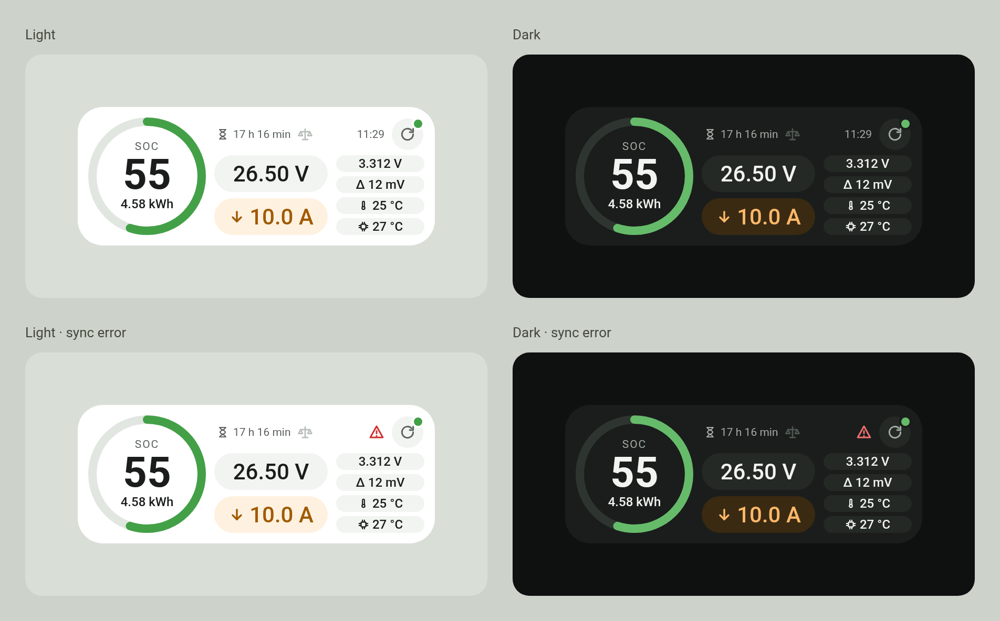
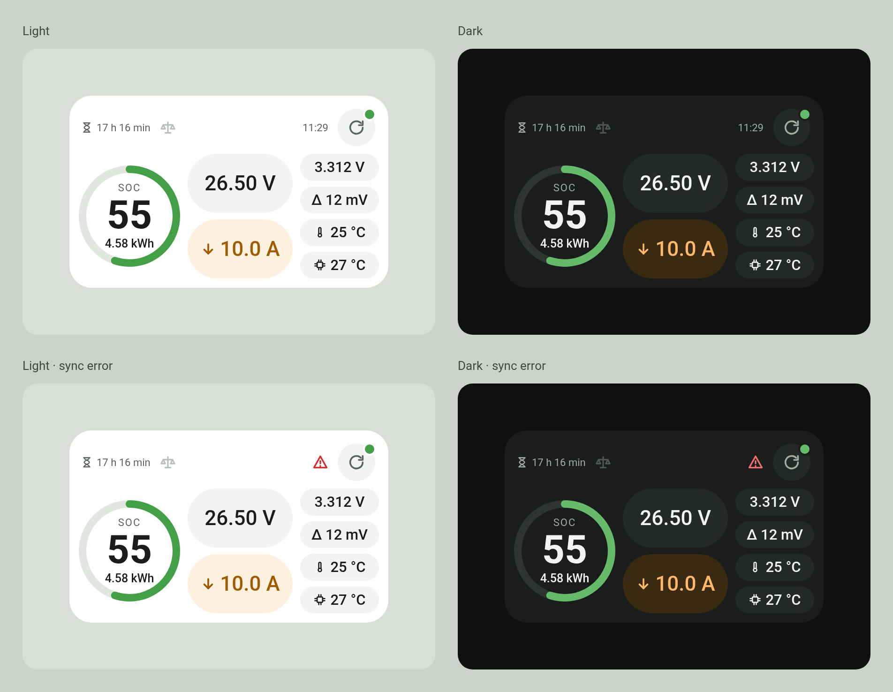
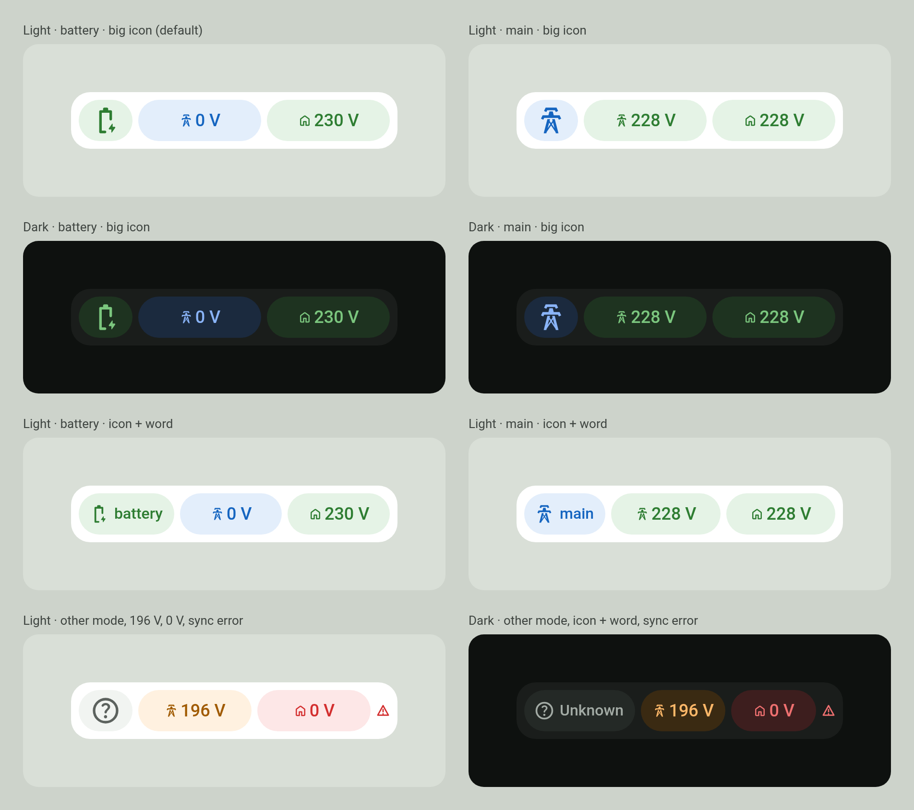

# Widget design — 4×2, 5×2, 4×3, 5×3

The inverter strip (3×1, 4×1, 5×1, spec 0012) has its own section near the
end, "Inverter strip". The app's Modes section (spec 0014) follows it,
"Mode editor".

Status: approved (v5), built in spec 0005 (layouts); temperatures in
spec 0004. Built before: v4 (one 4×2 layout, spec 0003).

The design was made on a design canvas; this folder keeps the latest
version in the repo. Current version: **v5**. On the canvas the v5 row has
one column per size: light, dark, sync error light, sync error dark. Git
keeps the older versions of this folder (v4 up to commit d1cf5fc:
`widget-4x2.html` and an older `widget-4x2.png`).

| File | What it is |
|---|---|
| `widget-4x2.png` | 4×2, card 267 × 132 dp: light, dark, sync error light and dark |
| `widget-5x2.png` | 5×2, card 340 × 132 dp: the same four frames |
| `widget-4x3.png` | 4×3, card 267 × 205 dp: the same four frames |
| `widget-5x3.png` | 5×3, card 340 × 205 dp: the same four frames |

The PNGs are rendered at 2× scale; 1 px of the design = 1 dp.






## Sizes

Card sizes are the owner's home screen grid (font scale 1.0, measured
2026-11-15). Each size has its own layout; it is not one layout scaled.

Home-screen scale: the owner's HyperOS launcher draws widgets at about
78 % of their size, so the widget multiplies every size and font below by
1.28 to look like the design there (spec 0005 §8). This is the Widget
setting "Home-screen scale" (spec 0007): default 100 %, the owner uses
128 % on HyperOS.

Main rule (as in v4): the most important data sits on the left, and
importance drops to the right, then down: SOC, then pack voltage and
current, then cell details.

| | 4×2 | 5×2 | 4×3 | 5×3 |
|---|---|---|---|---|
| Card | 267 × 132 | 340 × 132 | 267 × 205 | 340 × 205 |
| Padding, corner | 10, 24 | 10, 24 | 10, 24 | 10, 24 |
| Top row | 32 high, full width | 32 high, beside the ring | 44 high, full width | 48 high, full width |
| Buttons (touch / circle / icon) | 32 / 30 / 16 | 32 / 30 / 16 | 44 / 36 / 18 | 48 / 40 / 20 |
| Ring (size, stroke) | 76, 7 | 112, 8 — full card height, left | 86, 7 | 108, 8 |
| Pack pills (voltage, current) | 2 stacked, 6 gap, 87.5 wide | 2 stacked, 6 gap, 118 wide | 2 stacked, 6 gap, 119.5 wide | 2 stacked, 7 gap, 115 wide |
| Cell pills | column 56 wide, 4 gap | column 74 wide, 4 gap | 2 × 2 grid under ring and pack, 20 high, 5 / 4 gap | column 74 wide, 6 gap |

All sizes in dp. Gaps: 8 between ring, pack and cells; 4 under the top row
(4×3: 7 between the upper part and the cell grid). Except in 5×2, ring and
pack share the width the cells leave equally, and the ring fills its column
up to the row height (owner, 2026-11-16; the PNGs show the older widths).
4×2 is too narrow for the 5×2 layout (the top row needs about 200 dp beside
the ring), so its top row spans the full width and the ring sits below it.

```
5×2                                 4×3                     5×3
╭─────╮ ⌛ 17 h ⚖ 11:29 (⟳)(↻)      ⌛ 17 h ⚖  11:29 (⟳)(↻)   ⌛ 17 h ⚖      11:29 (⟳)(↻)
│ SOC │ (26.50 V) (3.312 V)         ╭───╮ (  26.50 V  )     ╭─────╮ (26.50 V) (3.312 V)
│ 55  │ (       ) (Δ 12 mV)         │55 │ ( ↓ 10.0 A  )     │ SOC │ (       ) (Δ 12 mV)
│ kWh │ (↓10.0 A) (🌡 25 °C)        ╰───╯                   │ 55  │ (↓10.0 A) (🌡 25 °C)
╰─────╯ (       ) (▣ 27 °C)         (3.312 V) (Δ 12 mV)     ╰─────╯ (       ) (▣ 27 °C)
                                    (🌡 25 °C) (▣ 27 °C)
```

- **Top row:** time left, balancing icon, last update time (or the error
  icon, see States), auto-refresh toggle, manual refresh (right corner).
  The two button touch areas touch each other. 4×2 and 5×2 buttons are
  32 dp: below Android's 48 dp advice; the owner chose a 32 dp top row at
  2 rows.
- **Pack pills** fill their column. Neither value has a sign: the arrow and
  the colour show the direction. "↓ 125.5 A" and "↑ 3.98 kW" fit at the
  design card sizes; the widget fits its texts to the boxes at its bucket
  sizes (6 dp smaller, spec 0005), where these long values shrink a little
  ("↑ 3.98 kW" about 16 sp in 4×2). Corner 16 (owner, 2026-11-16).
- **Cell pills:** a small fixed gap, and the pills grow to fill the space,
  so the cell column starts and ends with the pack pills. Never spread the
  pills with big gaps. Round ends.
- **4 cell pills:** average cell voltage, cell delta, battery
  temperature, MOSFET temperature (always last); 3 when no battery sensor
  is set.
- **Temperature pills:** icon, 3–4 dp space, value. No arrows, no empty
  slot. The battery pill shows the **average of all battery sensors**.
- All pills show numbers only (no text labels).

## Font sizes

Design sizes per size (sp) = 50 % of the font settings; 100 % = twice the
design size, 10 % = a fifth (spec 0005). The small texts (top row, the ring's
"SOC" label, the empty state's reason) start bigger: their 50 % is 1.5 × the
design size (owner, 2026-11-16). Above 50 % each text grows only as far
as its box allows. The design sizes fit the longest values at the design
card sizes; at the bucket boxes long worst-case values like "↑ 3.98 kW"
shrink a little (about 16 sp in 4×2).

| Group | 4×2 | 5×2 | 4×3 | 5×3 |
|---|---|---|---|---|
| SOC number | 28 | 40 | 32 | 42 |
| kWh / Ah under SOC | 10 | 12 | 11 | 12.5 |
| "SOC" label in the ring | 8.5 | 10.5 | 9.5 | 11 |
| Main values (voltage, current or power) | 17 | 21 | 22 | 22 |
| Cell pill values | 11 | 12 | 13.5 | 15.5 |
| Small text (time left, update time) | 10.5 | 10.5 | 10.5 | 11 |

## States

| State | Widget |
|---|---|
| Normal | As above; the update time in the top row |
| Refreshing | The ↻ icon dims; everything else stays |
| Sync error, data exists | The last values stay. A red ⚠ icon replaces the update time. No error text on the widget; the icon's content description is "Sync error: <reason>", and the app shows the full text |
| One value missing | "—" in its place, e.g. "Δ —" |
| Full | SOC ≥ 100 % and not discharging: no time left ("—") |
| No data yet / setup needed | One centered message ("No data from Home Assistant" plus the reason, or "Set up in the app") and an "Open app" button |

**Time left** shows from 0.5 A in Android's narrow format: "45m",
"17h 16m", and from 24 h "2d 7h" (days and hours); Ukrainian as Android
writes it. Otherwise "—".

**Update time:** the time when the last sync was today, else only the
date in the app's language ("Nov 14", "14 лист.").

## Data

Entity names use the ESPHome JK-BMS naming with a user prefix, for example
`bps_bms` → `sensor.bps_bms_total_voltage`. Fill sets them from the prefix;
every id can also be typed by hand.

| Element | Source | Note |
|---|---|---|
| SOC | `sensor.<p>_state_of_charge` | |
| kWh left | computed | Ah left × total voltage / 1000; shown when "kWh" is chosen |
| Ah left | `sensor.<p>_capacity_remaining` | Shown when "Ah" is chosen; also input for kWh and time left |
| Voltage | `sensor.<p>_total_voltage` | |
| Current | `sensor.<p>_current` | Sets the state: idle when \|I\| ≤ 0.1 A, discharging below −0.1 A, charging above 0.1 A. Negative while discharging (confirmed on the owner's BMS) |
| Power | `sensor.<p>_power` | Shown when "power" is chosen, without the sign |
| Time left | computed | Discharging: Ah left / \|I\|. Charging: (full − Ah left) / I. From 0.5 A |
| Full capacity | `sensor.<p>_total_battery_capacity` | Optional; when empty or unavailable, the capacity typed in the app is used |
| Battery temperature | the list in the settings | The average of all listed sensors. Fill should add every battery sensor the BMS has, not only `sensor.<p>_temperature_sensor_1` (spec 0004) |
| MOSFET temp. | `sensor.<p>_power_tube_temperature` | |
| Average cell | `sensor.<p>_average_cell_voltage` | |
| Cell delta | `sensor.<p>_delta_cell_voltage` | Reported in V, shown in mV |
| Balancing | `sensor.<p>_balancing` | Read-only; `on`/`off`, `true`/`false` or `1`/`0` |
| Update time | app | Time of the last successful sync; only the date when it was on an earlier day |
| Auto refresh | app setting | The widget toggle turns periodic sync on or off; with no interval set, it uses 15 min |

## Colours and levels

| Element | Rule |
|---|---|
| SOC ring | green ≥ 25 %, amber < 25 %, red < 15 % |
| Current / power pill | amber when discharging, green when charging, grey when idle |
| Delta pill | plain ≤ 15 mV, amber > 15 mV, red > 40 mV |
| Battery temperature pill | shows the average; the colour comes from the worst sensor (spec 0004): amber below 5 °C or above 45 °C; red at 0 °C or below, or above 55 °C |
| MOSFET pill | amber above 65 °C, red above 80 °C |
| Sync error icon | red ⚠ |
| Balancing icon | green when on, grey when off |
| Auto-refresh toggle | green tonal when on; grey with a slash when off |
| Refresh button | grey; dimmed while refreshing |

Theme tokens (light / dark) are the same as in v4:

| Token | Light | Dark |
|---|---|---|
| Card | `#FFFFFF` | `#1A1D1B` |
| Text | `#1B1D1C` | `#F1F4F1` |
| Secondary text | `#5C625E` | `#A3ABA5` |
| Dim (off icons) | `#B9C0BA` | `#4E5651` |
| Pill / tile | `#F1F4F1` | `#242926` |
| Ring track | `#E1E6E1` | `#2E3530` |
| Ring bar | `#43A047` | `#66BB6A` |
| Accent (green) | `#2E7D32` | `#7BC67E` |
| Green tint | `#E5F3E6` | `#1E3320` |
| Amber text / tint / ring | `#A05A00` / `#FFF1E0` / `#F59E0B` | `#FFB869` / `#3A2A12` / `#FFB74D` |
| Red text / tint | `#D32F2F` / `#FDE7E7` | `#EF7070` / `#3D1E1E` |

The app theme is green; no blue.

## Notes for the build

- Each size is its own layout. Fill the real space with weights, not with
  computed widths (lesson from the 0004 size trials).
- The ring is a bitmap drawn at run time, with the content description
  "State of charge N percent" (as in v4).
- Every icon-only element needs a content description: current direction,
  balancing, sync error (with the reason), battery temperature, MOSFET,
  both buttons.
- `minSdk` is 26. Glance's rounded corners work only from Android 12
  (likely); older versions need rounded background drawables for the pills
  and the card.
- The app shows the real widget as its preview (Glance `compose()`, spec
  0006), so there is no second drawing to keep in sync.

## Inverter strip — 3×1, 4×1, 5×1 (v6)

Status: approved (v6 layout and v7 modes, 2026-11-19), for spec 0012; not
built yet. A second widget with its own settings tab. On the canvas the v6
row has one column per size and eight lines (both mode styles, light,
dark, sync error); the v7 row shows every inverter mode at 4×1 (big icon
light and dark, icon + word in English and Ukrainian) and at 3×1
(Ukrainian words).

| File | What it is |
|---|---|
| `inverter-3x1.png` | 3×1, card 194 × 59 dp: eight frames (see the captions) |
| `inverter-4x1.png` | 4×1, card 267 × 59 dp: the same eight frames |
| `inverter-5x1.png` | 5×1, card 340 × 59 dp: the same eight frames |
| `inverter-modes.png` | Every mode (rows) in five looks (columns), cards only |

Rendered at 2× scale, like the battery pictures.





### Strip layout

All sizes in dp; the three columns are 3×1 / 4×1 / 5×1.

| Part | 3×1 | 4×1 | 5×1 |
|---|---|---|---|
| Card | 194 × 59 | 267 × 59 | 340 × 59 |
| Card padding, corner radius | 8, 20 | 8, 20 | 8, 20 |
| Gap between pills | 3 | 4 | 6 |
| Mode pill, big icon | icon 28, padding 8 | icon 32, padding 12 | icon 32, padding 12 |
| Mode pill, icon + word | icon 20 over the word (10.5), word ≤ 44 wide | icon 22, gap 5, word 14, ≤ 72 wide | icon 22, gap 5, word 16, ≤ 90 wide |
| Voltage pills | icon 11, gap 2, value 12.5 | icon 13, gap 2, value 15 | icon 15, gap 2, value 18 |

- Left to right: mode pill, grid input voltage, output voltage, and on a
  sync error a red ⚠ (14) at the end. Every pill is 43 high and fully
  round; the mode pill keeps its content width (at least 43), the two
  voltage pills share the rest equally (weights). Text weight 500.
- Voltages in whole volts ("230 V"). A long mode word ends with "…".
- No update time and no buttons on the strip; a tap opens the app on the
  Inverter tab.

The numbers were confirmed on the owner's phone on 2026-11-21 (3×1, 4×1,
5×1) with no tuning.

### Icons and colours

- Modes (spec 0012 mode table; text and soft background from the 0010
  palette; the user can change each icon):

  | ESP32 text | Word EN / UK | Colour | Icon |
  |---|---|---|---|
  | `Power On` | power on / запуск | grey | `power_settings_new` |
  | `Standby` | standby / пауза | teal | `mode_standby` |
  | `Mains` | main / мережа | blue | tower (`mdi` `transmission-tower`) |
  | `Off-Grid` | battery / батарея | green | `battery_charging_full` |
  | `Bypass` | bypass / байпас | violet | `alt_route` |
  | `Charging` | charging / заряд | amber | `charger` |
  | `Fault` | fault / аварія | red | `error` |
  | any other text | the HA text as it is | grey | `help` |

- Voltage icons: grid input = tower, output = `home`.
- Voltage pills by the 0012 default levels: below 100 V grid blue / output
  red, from 100 amber, from 207 green, from 254 red.

### Strip states

| State | Strip |
|---|---|
| Normal | As above |
| Sync error, data exists | The last values stay; a red ⚠ at the end (content description "Sync error: <reason>") |
| Unknown mode text | `help` icon, grey; with "icon + word" the HA text as it is |
| No data yet / setup needed | The tower icon and one line: "No data" or "Set up in the app"; no button |

## Mode editor — Modes section of the Inverter tab (v9)

Status: approved by the owner (2026-11-21), for spec 0014. v9 reworks v8
after the owner's phone check: the right side of the rows, type tags, the
current mode, shorter "other" words. An app screen, not a widget: the
Modes section on the Inverter tab, below Icons. On the canvas the v9 row
("Mode editor · v9") also shows the option the owner did not pick (B: only
the "now" badge, no ring). Git keeps v8 (three light frames) in the older
`mode-editor.png`.

| File | What it is |
|---|---|
| `mode-editor.png` | Six frames: view and editor in dark, light and Ukrainian (dark) |

Rendered at 2× scale from the canvas boards (the app's own drawables, the
0010 palette, the app theme colours); 1 px of the design = 1 dp, on the
owner's 390 dp screen (card content 326 dp). The spec decides the
behaviour; this picture shows the layout.


- **View row** (min 56 dp, padding 8 × 4, radius 14): the mode pill
  (36 × 28, icon in the mode colour, ring 1.5), 12 dp, the word in the
  mode colour with its texts under it (12 sp, grey), then on the right the
  **type tag** and the **bell at the far right**, so the bells form one
  column. "Default" and "Edit" above the rows.
- **Type tag:** the level tags' style, smaller: 12 sp medium, padding
  8 × 2, the type colour's background and text (Info blue, Warning amber,
  Critical red, Normal green). Short words: Info, Warning, Critical,
  Normal; UK Інфо, Увага, Критично, Норма.
- **Current mode:** the row of the mode Home Assistant sends now gets a
  1.5 dp ring in the mode's ring colour and a "now" badge (11 sp bold,
  the ring colour as background) after the word. A text no mode lists
  marks "other", whose second line then shows the text in quotes. No text:
  no row is marked. There is no "Now:" text line.
- **"other":** the word "other" (UK "інший"), the line "any other text"
  (UK "будь-який інший текст").
- **Editor:** Cancel and Save above and below the rows, a divider between
  rows. A closed row: pill, word, "now" badge, expand arrow; on the right
  the type tag with ▾ (13 sp; it opens the type menu with the full type
  words), then the bell toggle at the far right. The ring follows the
  draft. One open mode: icon button (opens the icon grid), "Name" field
  (placeholder = the default word, "Blank = …" under it), "Home Assistant
  texts" as chips with ✕, an "Add text" field with a round + button, eight
  colour chips (red, orange, amber, green, teal, blue, violet, grey; the
  type's colour carries a dot), "✕ Delete mode". "+ Add mode" under the
  last row.
- **New mode:** bell off, type Info, `help` icon, grey; a blank name shows
  its first text ("Utility").
